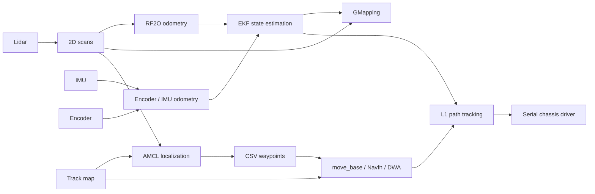

# Ares · Autonomous Driving

**National Second Prize Solution · China Artificial Intelligence Competition · Intelligent Driving Task 1**

[中文](README.zh-CN.md) | **English**

A ROS 1 autonomous driving competition project. This repository organizes the competition source code, hardware drivers, mapping and navigation configurations, track maps, and historical waypoints for presentation, code study, and reproduction research.

## Approach

- **Hardware integration:** LS01B lidar, serial IMU, wheel encoder, and a serial chassis driver, with alternative RPLIDAR and HI226 implementations retained.
- **Mapping and localization:** GMapping, AMCL, encoder/IMU odometry, RF2O laser odometry, and `robot_localization` EKF configurations.
- **Planning and tracking:** `move_base`, Navfn global planning, DWA local planning configurations, and a separate L1 look-ahead path tracking controller.
- **Waypoint missions:** CSV pose loading, navigation goal publication, and cyclic route progression using AMCL poses.
- **Auxiliary perception:** lidar-based obstacle geometry processing and OpenCV scripts for red/blue visual boundary processing.

These modules have separate entry points. The default hardware launch uses LS01B, `serial_imu`, and the encoder; the auxiliary perception modules are not automatically started by the main navigation launch. See the [architecture notes](docs/ARCHITECTURE.md).



The diagram summarizes relationships found in the code. Mapping and navigation run separately; launch files define the actual topics and transforms.

## Repository layout

```text
.
├── README.md                     # English README
├── README.zh-CN.md               # Chinese README
├── docs/                         # Architecture, reproduction, migration, notices
├── scripts/                      # Repository validation tool
├── src/                          # Catkin source directory
│   ├── core/
│   │   ├── racecar/              # Mapping, navigation, control, maps, vision
│   │   ├── multi_goal/           # Waypoint missions and waypoints/ CSV data
│   │   └── find_obj/             # Lidar obstacle geometry processing
│   ├── drivers/
│   │   ├── encoder_driver/       # Encoder and IMU odometry
│   │   ├── racecar_driver/       # Chassis serial control
│   │   ├── ls01b/                # ROS package name: ls01b_v2
│   │   ├── serial_imu/           # Serial IMU decoding
│   │   ├── imu_launch/           # IMU launch configurations
│   │   └── hi226_imu/            # Alternative IMU driver
│   └── third_party/
│       ├── rf2o_laser_odometry/  # Laser odometry
│       ├── imu_tool/             # Filters and RViz plugin; three ROS packages
│       ├── rplidar_ros/          # Alternative lidar ROS driver
│       └── serial/               # C++ serial library
└── third_party/rplidar_sdk/       # Standalone SDK outside the Catkin source tree
```

All **15 ROS packages** retain their names and `$(find package)` references. Maps remain in [`racecar/map`](src/core/racecar/map/); CSV routes are grouped under [`multi_goal/waypoints`](src/core/multi_goal/waypoints/).

## Build preparation

The target platform is Linux with ROS 1 and Catkin. The main project scripts use Python 3; the original ROS distribution was not recorded. The supplied controller and chassis static libraries contain **Linux x86-64** objects. ARM deployment requires the corresponding source code or rebuilt libraries.

From a terminal with a compatible ROS 1 installation:

```bash
git clone https://github.com/Z13156D2/ares-autonomous-driving.git
cd ares-autonomous-driving
source /opt/ros/<your_ros_distro>/setup.bash

# First-time rosdep setup: run sudo rosdep init before rosdep update.
rosdep update
rosdep install --from-paths src --ignore-src -r -y --skip-keys=python-serial
sudo apt-get install python3-serial python3-numpy python3-rospkg

catkin_make -DPYTHON_EXECUTABLE=/usr/bin/python3
source devel/setup.bash
```

Replace `<your_ros_distro>` with the installed ROS 1 distribution. The historical `python-serial` key is handled with the Python 3 package above. Original manifests do not fully declare every runtime dependency; follow the [reproduction guide](docs/REPRODUCTION.md) for the remaining checks.

## Main entry points

Source ROS and this repository's `devel/setup.bash` in every terminal. Configure serial devices, sensor calibration, and the chassis command convention before running vehicle launch files.

| Purpose | Command | Notes |
| --- | --- | --- |
| Hardware | `roslaunch racecar Run_car.launch` | LS01B, IMU, encoder, chassis, static transforms |
| Mapping | `roslaunch racecar Run_gmapping.launch` | Start after hardware |
| Keyboard control | `rosrun racecar racecar_teleop.py` | For manual mapping; see script for keys |
| Save a map | `bash "$(rospack find racecar)/save_map.sh" mymap_new` | Writes into `racecar/map/` |
| Localization and navigation | `roslaunch racecar amcl_nav.launch` | Uses `mymap_6.yaml` and starts path tracking |
| Select a map | `roslaunch racecar amcl_nav.launch map_file:=/absolute/path/map.yaml` | The referenced image must exist |
| Cyclic waypoints | `rosrun multi_goal goal_loop.py _csv_file:=/absolute/path/route.csv` | Requires localization and navigation |
| Record waypoints | `rosrun multi_goal getpoints.py _csv_file:=/tmp/ares_route.csv` | Records `/encoder_imu_odom`; default output: `~/ares_waypoints.csv` |

Waypoint CSV files have no header and contain four columns: `x,y,qz,qw`, representing planar position and the z/w quaternion components. The recorder uses odometry coordinates, whereas navigation defaults to the `map` frame. Check their transform before reusing recorded points for navigation. Run recording and cyclic navigation separately.

## Documentation and validation

- [Architecture, topics, and module entry points](docs/ARCHITECTURE.md)
- [Environment, hardware setup, and known limitations](docs/REPRODUCTION.md)
- [Original-to-new directory mapping](docs/REPOSITORY_LAYOUT.md)
- [Third-party provenance and licensing](docs/THIRD_PARTY_NOTICES.md)

Run `python scripts/check_repository.py` to check package names, XML, map references, route data, and primary Python entry points. This static check does not replace a ROS build, sensor calibration, or vehicle testing. The supporting guides are written in Chinese, with commands and code identifiers retained in English.

## Third-party components and licensing

This project integrates and modifies existing ROS drivers, algorithms, and tools. Original third-party copyright notices, license files, and source headers are retained; see the [notices](docs/THIRD_PARTY_NOTICES.md). Several original package manifests still contain `TODO` licenses. No repository-wide license was added during organization; check the applicable terms for each component before reuse or redistribution.
