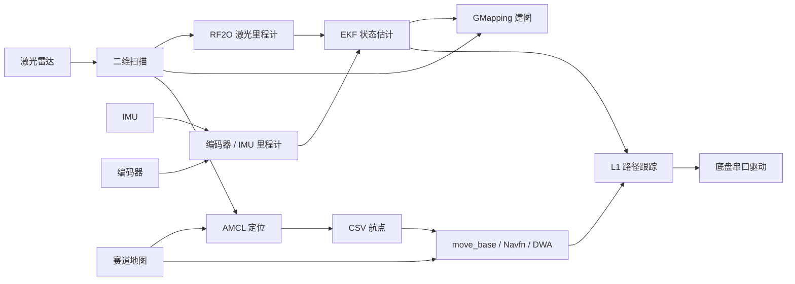

# Ares · 智能驾驶

**中国人工智能大赛 · 国家二等奖方案｜智能驾驶赛任务一**

**中文** | [English](README.md)

基于 ROS 1 的智能驾驶竞赛工程。本仓库整理并保留参赛源程序、驱动、建图与导航配置、赛道地图和历史航点，供方案展示、代码阅读与复现研究使用。

## 方案概览

方案围绕实车的感知、定位、规划和控制构建，主要包含：

- **传感器与底盘接入**：LS01B 激光雷达、串口 IMU、编码器和底盘串口驱动；保留 RPLIDAR 与 HI226 的备选接入代码。
- **建图与定位**：GMapping 建图、AMCL 定位，以及编码器、IMU、RF2O 激光里程计和 `robot_localization` EKF 相关实现与配置。
- **路径规划与跟踪**：`move_base`、Navfn 全局规划、DWA 局部规划配置，以及独立的 L1 前视路径跟踪控制器。
- **多航点任务**：从 CSV 读取目标位姿，发布导航目标，并根据 AMCL 位姿推进循环路线。
- **辅助感知**：基于激光扫描的障碍物几何处理，以及基于 OpenCV 的红蓝边界视觉处理脚本。

上述模块并非全部由同一个 launch 启动。默认硬件入口使用 LS01B、`serial_imu` 与编码器；视觉和激光障碍物处理属于独立入口，详见[架构说明](docs/ARCHITECTURE.md)。



图示概括代码中的数据关系；建图与导航分别启动，具体话题和 TF 配置以 launch 为准。

## 仓库结构

```text
.
├── README.md                     # English documentation
├── README.zh-CN.md               # 中文说明
├── docs/                         # 架构、复现、整理记录与依赖说明
├── scripts/                      # 仓库静态检查工具
├── src/                          # Catkin 源码目录
│   ├── core/
│   │   ├── racecar/              # 建图、导航、控制、地图、视觉脚本
│   │   ├── multi_goal/           # 多目标点任务与 waypoints/ CSV 数据
│   │   └── find_obj/             # 激光障碍物几何处理
│   ├── drivers/
│   │   ├── encoder_driver/       # 编码器与 IMU 组合里程计
│   │   ├── racecar_driver/       # 底盘控制串口
│   │   ├── ls01b/                # ROS 包名：ls01b_v2
│   │   ├── serial_imu/           # 串口 IMU 数据解码
│   │   ├── imu_launch/           # IMU 启动配置
│   │   └── hi226_imu/            # 备选 IMU 驱动
│   └── third_party/
│       ├── rf2o_laser_odometry/  # 激光里程计
│       ├── imu_tool/             # 滤波与 RViz 插件，共三个 ROS 包
│       ├── rplidar_ros/          # 备选激光雷达 ROS 驱动
│       └── serial/               # C++ 串口库
└── third_party/rplidar_sdk/       # 独立 SDK，不属于 Catkin 源码目录
```

共保留 **15 个 ROS 包**，包名及 `$(find 包名)` 引用保持兼容。地图位于 [`racecar/map`](src/core/racecar/map/)，航点集中在 [`multi_goal/waypoints`](src/core/multi_goal/waypoints/)。

## 构建准备

目标环境为安装了 ROS 1 / Catkin 的 Linux。主要项目脚本使用 Python 3；原始 ROS 发行版未记录。原始控制器和底盘库为 **Linux x86-64** 静态库，迁移到 ARM 平台需要对应源码或重新编译的库。

在已安装并加载兼容 ROS 1 环境的终端中执行：

```bash
git clone https://github.com/Z13156D2/ares-autonomous-driving.git
cd ares-autonomous-driving
source /opt/ros/<your_ros_distro>/setup.bash

# 首次使用 rosdep 时先执行 sudo rosdep init，再执行 rosdep update。
rosdep update
rosdep install --from-paths src --ignore-src -r -y --skip-keys=python-serial
sudo apt-get install python3-serial python3-numpy python3-rospkg

catkin_make -DPYTHON_EXECUTABLE=/usr/bin/python3
source devel/setup.bash
```

`<your_ros_distro>` 需替换为实际安装的 ROS 1 发行版。历史清单中的 `python-serial` 使用上面的 Python 3 包替代；部分运行依赖没有完整写入旧清单，请继续按[复现指南](docs/REPRODUCTION.md)核对。

## 主要运行入口

每个终端先加载 ROS 环境与本仓库 `devel/setup.bash`。先完成串口绑定、传感器校准和底盘控制量核对，再运行实车入口。

| 目的 | 命令 | 说明 |
| --- | --- | --- |
| 启动硬件 | `roslaunch racecar Run_car.launch` | LS01B、IMU、编码器、底盘与静态 TF |
| 建图 | `roslaunch racecar Run_gmapping.launch` | 在硬件已启动后运行 |
| 键盘遥控 | `rosrun racecar racecar_teleop.py` | 建图时使用，具体按键见脚本 |
| 保存地图 | `bash "$(rospack find racecar)/save_map.sh" mymap_new` | 保存到 `racecar/map/` |
| 定位与导航 | `roslaunch racecar amcl_nav.launch` | 默认 `mymap_6.yaml`，包含路径跟踪控制器 |
| 切换地图 | `roslaunch racecar amcl_nav.launch map_file:=/absolute/path/map.yaml` | YAML 对应的图像文件须存在 |
| 循环航点 | `rosrun multi_goal goal_loop.py _csv_file:=/absolute/path/route.csv` | 依赖已运行的定位与导航 |
| 采集航点 | `rosrun multi_goal getpoints.py _csv_file:=/tmp/ares_route.csv` | 记录 `/encoder_imu_odom`，默认写入 `~/ares_waypoints.csv` |

CSV 无表头，每行四列：`x,y,qz,qw`，表示平面位置与姿态四元数的 z、w 分量。采集脚本使用里程计坐标，导航脚本默认使用 `map` 坐标；用于导航前必须确认二者的坐标关系。采集与循环导航请分开进行。

## 阅读与复现

- [架构、话题与模块入口](docs/ARCHITECTURE.md)
- [环境、硬件配置与已知限制](docs/REPRODUCTION.md)
- [原始目录到新目录的对应关系](docs/REPOSITORY_LAYOUT.md)
- [第三方来源与许可说明](docs/THIRD_PARTY_NOTICES.md)

整理后可执行 `python scripts/check_repository.py` 检查包名、XML、地图引用、航点数据和主要 Python 入口。该检查不替代 ROS 编译、传感器标定或实车验证。

## 第三方与许可

本工程集成并修改了多个已有 ROS 驱动、算法与工具。第三方代码保留原始版权、许可文件和注释，详见[第三方说明](docs/THIRD_PARTY_NOTICES.md)。部分原始包的许可仍为 `TODO`，本次整理未为整个仓库新增统一许可证；使用与再分发时请逐项核对。
